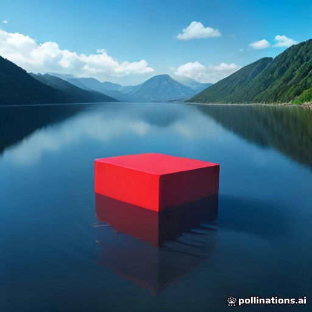

[](https://pollinations.ai/?ref=badge)

# PollinationsCraft

Add Pollinations AI to a Paper server with one plugin, paid with your own
[Pollen](https://enter.pollinations.ai/keys):

- **Villagers with personas.** An admin spawns an NPC with a character
  ("a grumpy old blacksmith who secretly writes poetry"); players right-click
  it or use `/polli say` and it answers in character. Each NPC can run its own
  model.
- **NPCs remember.** Every NPC keeps the tail of its conversation **per
  player**, in `memory.yml`, so the blacksmith still knows you after a
  restart.
- **Rooms.** `/polli join <npc>` turns a conversation public: everyone who
  joined hears what the room says and the NPC's answer, so an NPC can host a
  small audience.
- **Pictures on real maps.** `/polli image <prompt>` generates a picture with
   the Pollinations image API, paints it onto a 128×128 in-game map and hands
   it to the player. Every map and every source picture is saved under the
   plugin folder, so pictures survive restarts and the owner can audit them.
- **The live model lists.** `/polli models` reads
  [text](https://gen.pollinations.ai/text/models) and
  [image](https://gen.pollinations.ai/image/models) models straight from the
  gateway; any name from those pages works in the config or for an NPC.
- **Spending stays visible.** Every answer and picture prints its cost in
  Pollen. A short cooldown, an hourly cap per player and a daily picture
  budget keep one player from spending the month.

Every AI call is billed to the API key in the config, so the plugin costs its
owner Pollen and nothing else.

## Install

1. Run a [Paper](https://papermc.io) 1.21 server on Java 21.
2. Download `pollinations-craft-1.1.0.jar` from the
   [latest release](https://github.com/rekty/pollinations-craft/releases)
   into `plugins/`.
3. Start the server once: it creates `plugins/PollinationsCraft/config.yml`.
4. Create an API key at <https://enter.pollinations.ai/keys> and put it into
   `plugins/PollinationsCraft/config.yml`:

   ```yaml
   api-key: "pk_your_key_here"
   ```

5. Run `/polli reload`. Done. The console warns if a model in the config is
   not on the live list, needs paid Pollen or is down.

Without a key the plugin still loads, and every AI command tells the player
that the owner has to set one up first.

## Commands

| Command | Who | What it does |
| --- | --- | --- |
| `/polli npc create <name> <persona>` | admin | Spawns a villager NPC. Players spawn it two blocks ahead of themselves; the console spawns it at world spawn. |
| `/polli npc remove <name>` | admin | Removes the NPC, its villager and its saved data. |
| `/polli npc list` | everyone | Lists the NPCs. |
| `/polli say <npc> <message>` | everyone | Talks to an NPC. The answer and its Pollen cost come back to you. |
| `/polli join <npc>` | everyone | Your chat lines go to that NPC for ten minutes and the room sees them. `bye` leaves. |
| `/polli image <prompt>` | everyone | Generates a picture and gives you a map showing it. |
| `/polli models [text\|image]` | everyone | Shows the live model list. |
| `/polli reload` | admin | Re-reads `config.yml`. |

Right-clicking an NPC starts the same conversation as `/polli say`, from
chat. Type `bye` to stop, or wait three minutes.

## Permissions

| Node | Default | Covers |
| --- | --- | --- |
| `pollinations.chat` | everyone | `ask`, `say`, `join`, right-click chat, `models` |
| `pollinations.image` | everyone | `image` |
| `pollinations.admin` | op | `npc create`, `npc remove`, `reload` |

## Config

`plugins/PollinationsCraft/config.yml`:

| Key | Default | Meaning |
| --- | --- | --- |
| `api-key` | empty | Your key from <https://enter.pollinations.ai/keys>. Keep it private. |
| `text-model` | `openai/gpt-5.4-nano` | Model for chat. Any name from <https://gen.pollinations.ai/text/models>. |
| `image-model` | `flux` | Model for `/polli image`. Any name from <https://gen.pollinations.ai/image/models>. |
| `memory.turns` | `12` | Conversation turns an NPC remembers per player. |
| `memory.characters` | `2000` | Character cap on what is sent back to the model. |
| `image.width`, `image.height` | `512` | Generated picture size, fitted into the map. |
| `daily-image-limit` | `40` | Pictures per player per day; `0` is unlimited. |
| `limits.cooldown-seconds` | `5` | Wait per player between two answers, and between two pictures; `0` turns it off. |
| `limits.chats-per-hour` | `60` | NPC answers and `/polli ask` per player per hour; `0` is unlimited. |
| `limits.images-per-hour` | `10` | Pictures per player per hour, on top of the daily limit; `0` is unlimited. |
| `announce-costs` | `true` | Print the Pollen cost after each answer. |

## Build

```bash
./gradlew build     # needs Java; the wrapper downloads Gradle and a JDK 21
```

The jar lands in `build/libs/`. `./gradlew test` runs the unit tests: the
model list parsing, the conversation memory, the map fitting maths and the
gateway client against a local HTTP server — no Pollinations account needed.

## How the plugin uses Pollinations

- Text: `POST https://gen.pollinations.ai/v1/chat/completions` with the
  persona as the system prompt and the saved conversation as history.
- Images: `GET https://gen.pollinations.ai/image/<prompt>` with the model and
  size; the key goes in the `Authorization` header, never in the link. The
  picture is fitted into the 128×128 map canvas.
- Models: `GET https://gen.pollinations.ai/text/models` and
  `/image/models`, fetched in the background at start and then at most once
  an hour, so a slow list never pauses the server.

## Run on a real server

The plugin above, on a plain [Paper 1.21.4-232](https://papermc.io) server on
Java 21, driven from the server console (full log in
[`evidence/console-log.txt`](evidence/console-log.txt)):

- `polli npc create Bjorn A grumpy old blacksmith who secretly writes poetry
  about iron` → `Bjorn the villager now stands at 2, -60, 0 (entity 21)`
- `polli say Bjorn Write me a short poem about iron, four lines.` → four
  lines back, in character, for `~ 0.00008614 Pollen`
- `polli image a red cube floating over a calm blue lake, digital art` →
  `Painted and saved; a copy is at plugins\PollinationsCraft\exports\…png`
- **Restarted the same server**: `1 saved map(s) restored`, and Bjorn still
  knows the player: *"I remember you've been asking about my craft and my
  iron poems."*

The picture the player got on their map, and the 128×128 map itself:




## License

MIT
